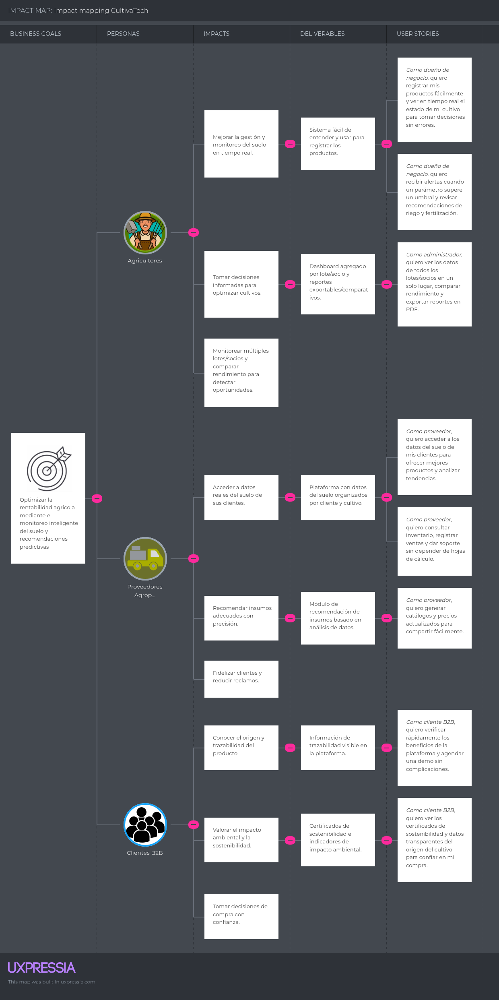

# Chapter III: Requirements Specification

## 3.1. User Stories

| EPIC ID | Nombre                                            | User Stories                                                     |
|---------|---------------------------------------------------|:-----------------------------------------------------------------|
| EPIC01  | Landing Page & Marketing                          | US01, US02, US03, US04, US05                                     |
| EPIC02  | Autenticación y Gestión de Usuarios               | US06, US07, US08, US09, US10                                     |
| EPIC03  | Monitoreo y Gestión de Sensores                   | US11, US12, US13, US14, US15                                     |
| EPIC04  | Alertas y Notificaciones                          | US16, US17, US18, US19, US20                                     |
| EPIC05  | Inventario y Catálogo                             | US21, US22, US23, US24, US25                                     |

---

- **EPIC01: Landing Page & Marketing**

| USER ID | Título | Descripción | Criterios de Aceptación | EPIC ID |
| :--- | :--- | :--- | :--- | :--- |
| **US01** | Visualización de Hero Section | Como visitante, deseo ver un mensaje claro sobre el valor de CultivaTech para comprender rápidamente qué ofrece la solución. | **Scenario 1: Carga correcta de la página** • **Given** el visitante accede al Landing Page • **When** la página termina de cargar • **Then** se visualiza el nombre de AgroTech, un título principal y una descripción breve • **And** se muestra un botón CTA "Solicitar Demo"  **Scenario 2: Acceso al formulario de demo** • **Given** el visitante está en el Hero Section • **When** hace clic en el botón "Solicitar Demo" • **Then** el sistema desplaza al visitante hacia el formulario de solicitud • **And** el tamaño de fuente del título es mínimo de 1.5rem | EPIC1 |
| **US02** | Visualización de Sección de Características | Como visitante, deseo conocer las características principales de CultivaTech para comprender sus funcionalidades. | **Scenario 1: Visualización de 3 características** • **Given** el visitante ha cargado el Landing Page • **When** hace scroll hasta la sección de características • **Then** se muestran exactamente tres características: "Sensor de Humedad", "Sensor de Nutrientes", "Alertas en Tiempo Real"  **Scenario 2: Ícono y descripción** • **Given** la sección de características está visible • **When** el visitante observa cada característica • **Then** cada una tiene un ícono (SVG o FontAwesome), título H3 y descripción de máximo 150 caracteres | EPIC1 |
| **US03** | Envío de Formulario de Solicitud de Demo | Como visitante, deseo completar un formulario para solicitar una demostración para recibir información sobre CultivaTech. | **Scenario 1: Envío correcto** • **Given** el visitante completa los campos requeridos • **When** hace clic en "Enviar" • **Then** el sistema registra la solicitud y muestra confirmación  **Scenario 2: Campos incompletos** • **Given** el visitante no completa campos requeridos • **When** intenta enviar el formulario • **Then** el sistema indica los campos pendientes y no registra la solicitud | EPIC1 |
| **US04** | Visualización de Términos y Condiciones | Como visitante, deseo leer los términos y condiciones de CultivaTech para conocer las condiciones de uso de la plataforma. | **Scenario 1: Acceso a términos** • **Given** el visitante está en el Landing Page • **When** selecciona "Términos y Condiciones" • **Then** el sistema muestra el contenido correspondiente  **Scenario 2: Visualización** • **Given** el visitante está en la sección de términos • **When** revisa la información • **Then** el contenido se muestra legible y ordenado | EPIC1 |
| **US05** | Visualización de Información del Proyecto y Equipo | Como visitante, deseo conocer información sobre el proyecto y el equipo de desarrollo para comprender el propósito de CultivaTech. | **Scenario 1: Visualización** • **Given** el visitante accede a la información del proyecto • **When** la sección carga • **Then** se muestra descripción de AgroTech e información general del equipo  **Scenario 2: Navegación** • **Given** el visitante está en el Landing Page • **When** selecciona la sección correspondiente • **Then** el sistema muestra la información del proyecto y equipo | EPIC1 |

---

- **EPIC02: Autenticación y Gestión de Usuarios**

| USER ID | Título | Descripción | Criterios de Aceptación | EPIC ID |
| :--- | :--- | :--- | :--- | :--- |
| **US06** | Registro de Nuevo Usuario | Como agricultor, deseo crear una cuenta en CultivaTech para acceder a la plataforma y gestionar mi información. | **Scenario 1: Registro correcto** • **Given** el visitante completa los campos requeridos • **When** confirma el registro • **Then** el sistema crea la cuenta y muestra un mensaje de éxito  **Scenario 2: Datos incompletos** • **Given** el visitante no completa los campos requeridos • **When** intenta registrarse • **Then** el sistema indica los campos pendientes y no crea la cuenta | EPIC2 |
| **US07** | Inicio de Sesión | Como usuario registrado, deseo iniciar sesión con mi correo y contraseña para acceder a mi información. | **Scenario 1: Inicio correcto** • **Given** el usuario tiene una cuenta registrada • **When** ingresa credenciales correctas • **Then** el sistema permite el acceso y muestra la pantalla principal  **Scenario 2: Credenciales incorrectas** • **Given** el usuario ingresa credenciales incorrectas • **When** intenta iniciar sesión • **Then** el sistema muestra mensaje de error y deniega el acceso | EPIC2 |
| **US09** | Visualización y Edición de Perfil | Como agricultor, deseo visualizar y editar mi perfil para mantener actualizada mi información. | **Scenario 1: Visualización del perfil** • **Given** el usuario ha iniciado sesión • **When** accede a su perfil • **Then** el sistema muestra su información registrada  **Scenario 2: Edición del perfil** • **Given** el usuario se encuentra en su perfil • **When** modifica datos y guarda • **Then** el sistema actualiza la información con confirmación | EPIC2 |
| **US10** | Cierre de Sesión | Como usuario registrado, deseo cerrar sesión para finalizar mi acceso a la plataforma de forma segura. | **Scenario 1: Cierre correcto** • **Given** el usuario ha iniciado sesión • **When** selecciona "Cerrar sesión" • **Then** el sistema finaliza la sesión y redirige al login  **Scenario 2: Acceso posterior** • **Given** el usuario ha cerrado sesión • **When** intenta acceder a sección protegida • **Then** el sistema solicita iniciar sesión nuevamente | EPIC2 |

---

- **EPIC03: Monitoreo y Gestión de Sensores**

| USER ID | Título | Descripción | Criterios de Aceptación | EPIC ID |
| :--- | :--- | :--- | :--- | :--- |
| **US11** | Visualización de Datos de Sensores | Como agricultor, deseo visualizar los valores registrados por mis sensores para conocer el estado de mi cultivo. | **Scenario 1: Visualización de datos** • **Given** el usuario tiene sensores registrados • **When** accede a monitoreo • **Then** el sistema muestra los datos identificando cada sensor  **Scenario 2: Sin sensores** • **Given** el usuario no tiene sensores registrados • **When** accede a monitoreo • **Then** el sistema informa que no existen sensores | EPIC3 |
| **US12** | Selección de Zona | Como agricultor, deseo seleccionar una zona de mi cultivo para consultar los sensores asociados a ella. | **Scenario 1: Selección correcta** • **Given** el usuario tiene zonas registradas • **When** selecciona una zona • **Then** se muestra la información asociada a dicha zona  **Scenario 2: Cambio de zona** • **Given** el usuario consulta una zona • **When** selecciona otra zona disponible • **Then** el sistema actualiza la información mostrada | EPIC3 |
| **US13** | Visualización del Historial de Humedad | Como agricultor, deseo consultar el historial de humedad de mis sensores para observar su comportamiento a lo largo del tiempo. | **Scenario 1: Historial disponible** • **Given** existen registros de humedad para una zona • **When** el usuario consulta el historial • **Then** se presentan los registros ordenados  **Scenario 2: Sin registros** • **Given** no existen registros de humedad • **When** se consulta el historial • **Then** el sistema informa que no hay datos disponibles | EPIC3 |
| **US14** | Registro de Nuevo Sensor | Como agricultor, deseo registrar un nuevo sensor indicando su código y zona para incorporarlo a mi cuenta. | **Scenario 1: Registro correcto** • **Given** el usuario completa la información del sensor • **When** confirma el registro • **Then** el sistema registra el sensor con confirmación  **Scenario 2: Información incompleta** • **Given** falta información requerida • **When** intenta registrar el sensor • **Then** el sistema indica datos pendientes y cancela registro | EPIC3 |
| **US15** | Consulta de Sensores Registrados | Como agricultor, deseo consultar mis sensores registrados para conocer cuáles están asociados a mi cuenta. | **Scenario 1: Sensores registrados** • **Given** el usuario tiene sensores registrados • **When** accede a la sección de sensores • **Then** el sistema muestra la lista con su información básica  **Scenario 2: Sin sensores** • **Given** el usuario no tiene sensores • **When** accede a la sección de sensores • **Then** el sistema indica que no existen registros | EPIC3 |

---

- **EPIC04: Alertas y Notificaciones**

| USER ID | Título | Descripción | Criterios de Aceptación | EPIC ID |
| :--- | :--- | :--- | :--- | :--- |
| **US16** | Alerta por Baja Humedad | Como agricultor, deseo recibir una alerta cuando la humedad de un sensor sea inferior al nivel establecido para identificar cuándo una zona requiere atención. | **Scenario 1: Humedad baja** • **Given** la humedad es inferior al rango establecido • **When** el sistema identifica la condición • **Then** genera una alerta identificando la zona afectada  **Scenario 2: Humedad en rango** • **Given** la humedad está dentro del rango • **When** el sistema revisa el valor • **Then** no se genera alerta | EPIC4 |
| **US17** | Alerta por Nutrientes Fuera de Rango | Como agricultor, deseo recibir una alerta cuando los nutrientes registrados estén fuera del rango establecido para identificar posibles problemas en el cultivo. | **Scenario 1: Nutrientes fuera de rango** • **Given** los nutrientes están fuera del rango • **When** el sistema detecta la anomalía • **Then** genera alerta identificando la zona correspondiente  **Scenario 2: Nutrientes en rango** • **Given** los nutrientes están en rango • **When** se revisan los valores • **Then** no se genera alerta | EPIC4 |
| **US18** | Consulta de Notificaciones | Como agricultor, deseo consultar las notificaciones generadas por el sistema para revisar las alertas de mi cultivo. | **Scenario 1: Notificaciones disponibles** • **Given** existen notificaciones registradas • **When** el usuario accede a la sección • **Then** el sistema muestra las notificaciones con sus detalles  **Scenario 2: Sin notificaciones** • **Given** no hay notificaciones • **When** el usuario accede a la sección • **Then** el sistema informa la ausencia de alertas | EPIC4 |
| **US19** | Configuración de Preferencias de Notificaciones | Como agricultor, deseo configurar qué tipos de alertas quiero recibir para adaptar las notificaciones a mis necesidades. | **Scenario 1: Configuración inicial** • **Given** el usuario accede a preferencias de notificaciones • **When** selecciona las alertas a recibir • **Then** el sistema guarda la configuración  **Scenario 2: Modificación** • **Given** el usuario modifica sus opciones • **When** guarda cambios • **Then** el sistema actualiza sus preferencias | EPIC4 |
| **US20** | Historial de Notificaciones | Como agricultor, deseo consultar las notificaciones anteriores para revisar las alertas que se generaron previamente. | **Scenario 1: Historial disponible** • **Given** existen notificaciones anteriores • **When** se accede al historial • **Then** se muestran las alertas indicando fecha y tipo  **Scenario 2: Historial vacío** • **Given** no existen notificaciones anteriores • **When** se accede al historial • **Then** el sistema informa que no hay registros | EPIC4 |

---

- **EPIC05: Inventario y Catálogo**

| USER ID | Título | Descripción | Criterios de Aceptación | EPIC ID |
| :--- | :--- | :--- | :--- | :--- |
| **US21** | Registro de Insumos | Como agricultor, deseo registrar insumos agrícolas en mi inventario para llevar un control de los productos disponibles. | **Scenario 1: Registro correcto** • **Given** el usuario completa los datos del insumo • **When** confirma el registro • **Then** el sistema registra el insumo con mensaje de confirmación  **Scenario 2: Datos incompletos** • **Given** faltan datos requeridos • **When** intenta registrar el insumo • **Then** el sistema indica campos pendientes y cancela registro | EPIC5 |
| **US22** | Visualización del Inventario | Como agricultor, deseo visualizar los insumos registrados para conocer los productos disponibles en mi inventario. | **Scenario 1: Inventario disponible** • **Given** el usuario tiene insumos registrados • **When** accede a la sección de inventario • **Then** el sistema muestra los productos y su cantidad disponible  **Scenario 2: Inventario vacío** • **Given** no hay insumos registrados • **When** accede al inventario • **Then** el sistema informa que no hay insumos | EPIC5 |
| **US23** | Actualización de Stock de Insumo | Como agricultor, deseo actualizar la cantidad disponible de un insumo para mantener actualizado mi inventario. | **Scenario 1: Actualización correcta** • **Given** el insumo existe en el sistema • **When** modifica la cantidad disponible y guarda • **Then** el sistema actualiza el stock  **Scenario 2: Cantidad no válida** • **Given** ingresa una cantidad no válida • **When** guarda cambios • **Then** muestra mensaje de error y conserva el valor anterior | EPIC5 |
| **US24** | Visualización de Catálogo de Productos | Como cliente, deseo consultar el catálogo de productos agrícolas para conocer los productos disponibles. | **Scenario 1: Catálogo disponible** • **Given** el usuario accede al catálogo • **When** la página termina de cargar • **Then** se muestran productos disponibles con su información básica  **Scenario 2: Catálogo sin productos** • **Given** no existen productos registrados • **When** se accede al catálogo • **Then** el sistema informa que no hay productos | EPIC5 |
| **US25** | Visualización de Detalle de Producto | Como cliente, deseo consultar el detalle de un producto para conocer mejor sus características antes de adquirirlo. | **Scenario 1: Consulta de producto** • **Given** el usuario visualiza el catálogo • **When** selecciona un producto • **Then** se muestra el detalle con su información completa  **Scenario 2: Producto no disponible** • **Given** el producto no está disponible • **When** consulta su detalle • **Then** el sistema informa que no está disponible | EPIC5 |

---

- **EPIC06: Profile Management**

| USER ID | Título | Descripción | Criterios de Aceptación | EPIC ID |
| :--- | :--- | :--- | :--- | :--- |
| **US26** | Creación del Perfil de Agricultor | Como agricultor recién registrado, deseo crear mi perfil de agricultor para poder acceder a la gestión de mis lotes y funciones del sistema. | **Scenario 1: Creación exitosa del perfil** • **Given** que el agricultor inicia sesión por primera vez y no cuenta con un perfil registrado  • **When** completa los datos obligatorios del perfil y confirma  • **Then** el sistema crea el perfil exitosamente y le permite el acceso al panel principal de gestión.  **Scenario 2: Intento de omisión del perfil** • **Given** que el agricultor no ha creado su perfil  • **When** intenta navegar a otras secciones del sistema  • **Then** el sistema lo redirige a la vista de creación de perfil impidiendo el avance. | EPIC6 |
| **US27** | Registro de Lote | Como agricultor, deseo registrar un nuevo lote (field) especificando sus dimensiones, tipo de suelo y coordenadas geográficas para llevar un control espacial de mis cultivos. | **Scenario 1: Registro correcto del lote** • **Given** que el agricultor cuenta con un perfil activo y completa los datos del lote (nombre, tamaño en $m^2$, tipo de suelo, latitud y longitud) • **When** confirma el registro del lote  • **Then** el sistema almacena el lote asociado a su perfil y muestra un mensaje de confirmación.   **Scenario 2: Datos geográficos o dimensiones inválidas** • **Given** que el agricultor intenta registrar un lote con medidas en $m^2$ negativas o coordenadas vacías  • **When** intenta guardar el lote  • **Then** el sistema indica los campos con errores y cancela el registro. | EPIC6 |
| **US28** | Visualización y Edición de Lotes | Como agricultor, deseo consultar y actualizar la información de mis lotes registrados para mantener actualizados los datos de mis áreas de cultivo. | **Scenario 1: Listado de lotes disponibles** • **Given** que el agricultor tiene lotes previamente registrados en su perfil  • **When** accede a la sección de gestión de lotes  • **Then** el sistema muestra la lista detallada con el nombre, tamaño, tipo de suelo y ubicación geográfica de cada lote.   **Scenario 2: Actualización de datos del lote** • **Given** que el agricultor selecciona un lote existente para modificar su tipo de suelo o tamaño  • **When** guarda los cambios realizados  • **Then** el sistema actualiza la información del lote y refresca la vista correctamente. | EPIC6 |

---

- **EPIC07: Inventory Management**

| USER ID | Título | Descripción | Criterios de Aceptación | EPIC ID |
| :--- | :--- | :--- | :--- | :--- |
| **US29** | Registro de Insumo Agrícola | Como agricultor, deseo registrar nuevos insumos agrícolas especificando su información y cantidad inicial para mantener actualizado mi inventario. | **Scenario 1: Registro exitoso del insumo** • **Given** que el agricultor se encuentra en la sección de inventario y desea registrar un nuevo insumo agrícola • **When** completa los datos obligatorios del insumo y confirma el registro • **Then** el sistema registra el insumo correctamente y lo incorpora al inventario.  **Scenario 2: Datos obligatorios incompletos** • **Given** que el agricultor intenta registrar un nuevo insumo agrícola • **When** omite uno o más datos obligatorios • **Then** el sistema muestra un mensaje de validación e impide completar el registro. | EPIC7 |
| **US30** | Actualización de Stock de Insumo | Como agricultor, deseo actualizar la cantidad disponible de mis insumos agrícolas para mantener un control preciso del stock de mi inventario. | **Scenario 1: Actualización exitosa del stock** • **Given** que el insumo agrícola se encuentra registrado en el inventario • **When** el agricultor modifica la cantidad disponible y confirma la operación • **Then** el sistema actualiza correctamente el stock del insumo.  **Scenario 2: Cantidad de stock inválida** • **Given** que el agricultor intenta actualizar el stock de un insumo • **When** ingresa una cantidad negativa o inválida • **Then** el sistema muestra un mensaje de validación e impide guardar la actualización. | EPIC7 |
| **US31** | Visualización y Filtrado de Inventario | Como agricultor, deseo visualizar y filtrar los insumos registrados para consultar fácilmente su información y disponibilidad de stock. | **Scenario 1: Visualización del inventario** • **Given** que el agricultor cuenta con insumos registrados • **When** accede a la sección de inventario • **Then** el sistema muestra la lista de insumos con su información y stock disponible.  **Scenario 2: Filtrado del inventario** • **Given** que el agricultor se encuentra visualizando su inventario • **When** aplica un criterio de búsqueda o filtrado • **Then** el sistema muestra únicamente los insumos que cumplen con el criterio seleccionado. | EPIC7 |
---

- **EPIC08: Community & Reputation**

| USER ID | Título | Descripción | Criterios de Aceptación | EPIC ID |
| :--- | :--- | :--- | :--- | :--- |
| **US32** | Visualización de Comentarios y Calificaciones de Fields y Productos | Como cliente B2B, deseo visualizar los comentarios y calificaciones de los fields y sus productos asociados para conocer la experiencia y reputación de los agricultores y sus productos. | **Scenario 1: Visualización de calificaciones de un field** • **Given** que un field cuenta con calificaciones y comentarios realizados por clientes B2B • **When** el cliente B2B consulta la información del field • **Then** el sistema muestra sus calificaciones y comentarios disponibles.  **Scenario 2: Visualización de calificaciones de productos** • **Given** que un field tiene productos asociados con calificaciones y comentarios • **When** el cliente B2B consulta un producto • **Then** el sistema muestra las calificaciones y comentarios correspondientes al producto. | EPIC8 |
| **US33** | Gestión de Reputación de Fields y Productos | Como agricultor, deseo consultar y gestionar la reputación de mis fields y productos a partir de las calificaciones y comentarios recibidos de clientes B2B para conocer la percepción sobre mi producción. | **Scenario 1: Consulta de reputación** • **Given** que los fields y productos del agricultor han recibido calificaciones de clientes B2B • **When** el agricultor accede a la sección de reputación • **Then** el sistema muestra el resumen de calificaciones y comentarios asociados a sus fields y productos.  **Scenario 2: Visualización de reputación por producto** • **Given** que un field tiene productos asociados con diferentes calificaciones • **When** el agricultor consulta la reputación de sus productos • **Then** el sistema muestra las calificaciones correspondientes a cada producto. | EPIC8 |
| **US34** | Publicación de Reseñas y Calificaciones de Fields y Productos | Como cliente B2B, deseo publicar una reseña y una calificación sobre un field o sus productos asociados para compartir mi experiencia con otros clientes. | **Scenario 1: Publicación exitosa de reseña** • **Given** que el cliente B2B ha adquirido o interactuado con un field o producto elegible para ser calificado • **When** registra una calificación y escribe una reseña • **Then** el sistema almacena y publica la reseña asociada al field o producto correspondiente.  **Scenario 2: Publicación sin calificación válida** • **Given** que el cliente B2B intenta publicar una reseña • **When** no proporciona una calificación válida • **Then** el sistema muestra un mensaje de validación e impide publicar la reseña. | EPIC8 |
| **US35** | Visualización de Reseñas y Calificaciones de Otros Clientes | Como cliente B2B, deseo visualizar las reseñas y calificaciones realizadas por otros clientes sobre los fields y productos para comparar experiencias antes de tomar decisiones de compra. | **Scenario 1: Consulta de reseñas de un field** • **Given** que otros clientes B2B han publicado reseñas sobre un field • **When** el cliente B2B consulta dicho field • **Then** el sistema muestra las reseñas y calificaciones publicadas por otros clientes.  **Scenario 2: Consulta de reseñas de un producto** • **Given** que un producto asociado a un field cuenta con reseñas de otros clientes B2B • **When** el cliente B2B consulta el producto • **Then** el sistema muestra las reseñas y calificaciones correspondientes. | EPIC8 |

---

- **EPIC09: Analytics Management**

| USER ID | Título | Descripción | Criterios de Aceptación | EPIC ID |
| :--- | :--- | :--- | :--- | :--- |
| **US36** | Visualización de Indicadores Agrícolas | Como agricultor, deseo visualizar indicadores sobre el estado y rendimiento de mis tierras de cultivo para conocer su situación actual y tomar mejores decisiones sobre su producción. | **Scenario 1: Visualización de indicadores agrícolas** • **Given** que el agricultor cuenta con información registrada de sus tierras de cultivo y sensores asociados • **When** accede al módulo de Analytics • **Then** el sistema muestra indicadores relevantes sobre el estado de sus cultivos, como humedad, condiciones del suelo y rendimiento histórico.  **Scenario 2: Consulta del comportamiento histórico** • **Given** que existen registros históricos de una tierra de cultivo • **When** el agricultor consulta los indicadores históricos • **Then** el sistema presenta la evolución de los principales indicadores agrícolas para facilitar su análisis. | EPIC9 |
| **US37** | Proyección de Cosechas | Como agricultor, deseo consultar proyecciones de mis futuras cosechas basadas en datos históricos de producción y condiciones actuales de mis cultivos para planificar mejor mi producción agrícola. | **Scenario 1: Generación de proyección de cosecha** • **Given** que existen datos históricos de cosechas y registros actuales de las tierras de cultivo • **When** el agricultor solicita la proyección de una futura cosecha • **Then** el sistema genera y muestra una estimación de la producción esperada para el periodo seleccionado.  **Scenario 2: Consulta de proyecciones** • **Given** que el sistema cuenta con proyecciones previamente generadas • **When** el agricultor consulta el historial de proyecciones • **Then** el sistema muestra las proyecciones disponibles y permite compararlas con los resultados históricos de producción. | EPIC9 |

---

- **EPIC10: Configuration and Deployment**

| USER ID | Título | Descripción | Criterios de Aceptación | EPIC ID |
| :--- | :--- | :--- | :--- | :--- |
| **TS01** | Configuración de Repositorios con GitFlow | Como backend developer, deseo configurar los repositorios utilizando GitFlow para establecer una estrategia organizada de ramas y flujo de trabajo que permita desarrollar, integrar y versionar los cambios de manera controlada. | **Scenario 1: Configuración exitosa de GitFlow** • **Given** que el equipo cuenta con un repositorio de código fuente • **When** configura la estrategia GitFlow y sus ramas principales • **Then** el repositorio dispone de una estructura de ramas definida para el desarrollo, integración y publicación de versiones.  **Scenario 2: Validación del flujo de trabajo** • **Given** que la estrategia GitFlow se encuentra configurada • **When** un desarrollador realiza cambios siguiendo el flujo establecido • **Then** los cambios pueden integrarse mediante el proceso de ramas y revisión definido por el equipo. | EPIC10 |
| **TS02** | Configuración de Base de Datos en la Nube | Como backend developer, deseo configurar la base de datos en la nube para disponer de un entorno centralizado, accesible y preparado para soportar los servicios del sistema en los diferentes ambientes de desarrollo y producción. | **Scenario 1: Conexión exitosa a la base de datos** • **Given** que la instancia de base de datos en la nube se encuentra configurada • **When** el backend intenta establecer una conexión utilizando las credenciales autorizadas • **Then** la conexión se establece correctamente.  **Scenario 2: Acceso no autorizado** • **Given** que un servicio intenta conectarse con credenciales inválidas • **When** solicita una conexión a la base de datos • **Then** el sistema rechaza la conexión y evita el acceso no autorizado. | EPIC10 |
| **TS03** | Configuración de Variables de Entorno | Como backend developer, deseo configurar las variables de entorno para gestionar de forma segura y flexible las credenciales, URLs, claves y demás parámetros necesarios para la ejecución de los servicios del sistema. | **Scenario 1: Carga correcta de variables** • **Given** que las variables de entorno requeridas están definidas • **When** se inicia la aplicación backend • **Then** el sistema carga los parámetros necesarios para su ejecución.  **Scenario 2: Ausencia de una variable obligatoria** • **Given** que falta una variable de entorno requerida • **When** se inicia la aplicación backend • **Then** el sistema identifica la configuración faltante y genera un error claro, evitando una ejecución incorrecta. | EPIC10 |
| **TS04** | Implementación de IAM en BackEnd | Como backend developer, deseo implementar el sistema de IAM en el BackEnd para gestionar la autenticación, autorización y control de acceso de los usuarios según sus roles y permisos dentro de la plataforma. | **Scenario 1: Acceso autorizado** • **Given** que un usuario cuenta con credenciales válidas y los permisos necesarios • **When** solicita un recurso protegido del backend • **Then** el sistema valida su identidad y permisos y permite el acceso.  **Scenario 2: Acceso no autorizado** • **Given** que un usuario no está autenticado o carece de los permisos requeridos • **When** intenta acceder a un recurso protegido • **Then** el sistema rechaza la solicitud y devuelve la respuesta de autorización correspondiente. | EPIC10 |
| **TS05** | Endpoint de Obtención de Datos de Sensor | Como backend developer, deseo implementar el endpoint de obtención de datos de sensores para permitir que la aplicación consulte y procese la información generada por los dispositivos IoT instalados en los campos agrícolas. | **Scenario 1: Obtención exitosa de datos** • **Given** que existen registros de sensores asociados a un dispositivo o lote • **When** un cliente autorizado solicita los datos mediante el endpoint correspondiente • **Then** el sistema devuelve los registros disponibles con su información y marcas de tiempo.  **Scenario 2: Consulta sin registros disponibles** • **Given** que no existen datos para los criterios de consulta especificados • **When** el cliente realiza la solicitud • **Then** el sistema devuelve una respuesta válida que indica que no hay registros disponibles. | EPIC10 |
| **TS06** | Endpoint de Community | Como backend developer, deseo implementar los endpoints del módulo de Community para permitir la gestión de perfiles, comentarios y reseñas de los usuarios dentro de la comunidad de CultivaTech. | **Scenario 1: Operación exitosa en Community** • **Given** que el usuario está autenticado y dispone de los permisos necesarios • **When** solicita una operación admitida sobre perfiles, comentarios o reseñas • **Then** el sistema procesa la solicitud y devuelve el resultado correspondiente.  **Scenario 2: Solicitud con datos inválidos** • **Given** que el usuario envía una solicitud con datos obligatorios incompletos o inválidos • **When** el backend procesa la solicitud • **Then** el sistema devuelve errores de validación sin guardar información incorrecta. | EPIC10 |
| **TS07** | Endpoint de Profile | Como backend developer, deseo implementar los endpoints del módulo de Profile para permitir la creación, consulta y actualización de la información de los perfiles de los usuarios y agricultores registrados en la plataforma. | **Scenario 1: Consulta y actualización del perfil** • **Given** que existe un perfil asociado al usuario autenticado • **When** el usuario consulta o actualiza sus datos mediante el endpoint correspondiente • **Then** el sistema devuelve la información autorizada o guarda los cambios válidos.  **Scenario 2: Acceso a un perfil no autorizado** • **Given** que un usuario intenta modificar un perfil sobre el que no tiene permisos • **When** envía la solicitud de actualización • **Then** el sistema rechaza la operación y conserva los datos existentes. | EPIC10 |
| **TS08** | Endpoint de Gestión de Inventario | Como backend developer, deseo implementar los endpoints de gestión de inventario para permitir registrar, consultar, filtrar y actualizar los insumos agrícolas y sus niveles de stock. | **Scenario 1: Operación exitosa de inventario** • **Given** que el usuario cuenta con los permisos necesarios para gestionar el inventario • **When** registra, consulta, filtra o actualiza un insumo mediante el endpoint correspondiente • **Then** el sistema procesa la operación y devuelve la información actualizada.  **Scenario 2: Actualización con cantidad inválida** • **Given** que el usuario intenta actualizar el stock de un insumo • **When** envía una cantidad negativa o que incumple las reglas de negocio • **Then** el sistema rechaza la actualización y conserva el stock anterior. | EPIC10 |
| **TS09** | Endpoint de Analytics | Como backend developer, deseo implementar los endpoints del módulo de Analytics para proporcionar indicadores agrícolas, datos históricos y proyecciones que permitan analizar el estado de los cultivos, estimar futuras cosechas y evaluar el comportamiento de los productos agrícolas. | **Scenario 1: Consulta de indicadores agrícolas** • **Given** que existen datos históricos y actuales disponibles para el análisis • **When** un usuario autorizado solicita los indicadores agrícolas • **Then** el sistema devuelve los indicadores calculados correspondientes al ámbito de consulta.  **Scenario 2: Proyección sin datos suficientes** • **Given** que no existe información suficiente para generar una proyección confiable • **When** el usuario solicita una proyección de cosecha • **Then** el sistema informa que no es posible generar la proyección con los datos disponibles. | EPIC10 |
| **TS10** | Endpoint de Notification | Como backend developer, deseo implementar los endpoints del módulo de Notification para permitir la creación, consulta y gestión de las notificaciones generadas por eventos relevantes del sistema. | **Scenario 1: Consulta de notificaciones** • **Given** que un usuario tiene notificaciones registradas • **When** consulta sus notificaciones mediante el endpoint correspondiente • **Then** el sistema devuelve las notificaciones asociadas a su cuenta.  **Scenario 2: Gestión del estado de una notificación** • **Given** que el usuario tiene una notificación pendiente y dispone de permisos para gestionarla • **When** solicita marcarla como leída • **Then** el sistema actualiza su estado y devuelve la confirmación de la operación. | EPIC10 |
| **TS11** | Endpoint de Monitoreo de Dispositivos IoT | Como backend developer, deseo implementar los endpoints para el monitoreo de dispositivos IoT para permitir consultar el estado, disponibilidad y funcionamiento de los dispositivos desplegados en los campos agrícolas. | **Scenario 1: Consulta del estado de un dispositivo** • **Given** que un dispositivo IoT está registrado en el sistema y existen datos de monitoreo • **When** un usuario autorizado consulta el estado del dispositivo • **Then** el sistema devuelve su estado registrado y la información de monitoreo disponible.  **Scenario 2: Dispositivo sin información reciente** • **Given** que un dispositivo no ha reportado información durante el intervalo definido por el sistema • **When** se consulta su estado • **Then** el sistema indica que no dispone de información reciente y refleja el estado de comunicación según las reglas de monitoreo configuradas. | EPIC10 |

\newpage

## 3.2. Impact Mapping

{height=500px}

\newpage

## 3.3. Product Backlog

## 3.3. Product Backlog

| # Orden | User Story Id | Título | Descripción | Story Points (1/2/3/5/8) |
| :--- | :--- | :--- | :--- | :--- |
| 1  | US01 | Visualización de Hero Section | Como visitante, deseo ver un mensaje claro sobre el valor de CultivaTech para comprender rápidamente qué ofrece la solución. | 2 |
| 2  | US02 | Visualización de Sección de Características | Como visitante, deseo conocer las características principales de CultivaTech para comprender sus funcionalidades. | 2 |
| 3  | US03 | Envío de Formulario de Solicitud de Demo | Como visitante, deseo completar un formulario para solicitar una demostración para recibir información sobre CultivaTech. | 5 |
| 4  | US04 | Visualización de Términos y Condiciones | Como visitante, deseo leer los términos y condiciones de CultivaTech para conocer las condiciones de uso de la plataforma. | 1 |
| 5  | US05 | Visualización de Información del Proyecto y Equipo | Como visitante, deseo conocer información sobre el proyecto y el equipo de desarrollo para comprender el propósito de CultivaTech. | 2 |
| 6  | US06 | Registro de Nuevo Usuario | Como agricultor, deseo crear una cuenta en CultivaTech para acceder a la plataforma y gestionar mi información. | 5 |
| 7  | US07 | Inicio de Sesión | Como usuario registrado, deseo iniciar sesión con mi correo y contraseña para acceder a mi información. | 3 |
| 8  | US08 | Recuperación de Contraseña | Como usuario registrado, deseo recuperar mi contraseña para volver a acceder a mi cuenta si la olvido. | 5 |
| 9  | US09 | Visualización y Edición de Perfil | Como agricultor, deseo visualizar y editar mi perfil para mantener actualizada mi información. | 3 |
| 10 | US10 | Cierre de Sesión | Como usuario registrado, deseo cerrar sesión para finalizar mi acceso a la plataforma de forma segura. | 2 |
| 11 | US11 | Visualización de Datos de Sensores | Como agricultor, deseo visualizar los valores registrados por mis sensores para conocer el estado de mi cultivo. | 5 |
| 12 | US12 | Selección de Zona | Como agricultor, deseo seleccionar una zona de mi cultivo para consultar los sensores asociados a ella. | 3 |
| 13 | US13 | Visualización del Historial de Humedad | Como agricultor, deseo consultar el historial de humedad de mis sensores para observar su comportamiento a lo largo del tiempo. | 5 |
| 14 | US14 | Registro de Nuevo Sensor | Como agricultor, deseo registrar un nuevo sensor indicando su código y zona para incorporarlo a mi cuenta. | 5 |
| 15 | US15 | Visualización de Sensores Registrados | Como agricultor, deseo consultar mis sensores registrados para conocer cuáles están asociados a mi cuenta. | 3 |
| 16 | US16 | Alerta por Baja Humedad | Como agricultor, deseo recibir una alerta cuando la humedad de un sensor sea inferior al nivel establecido para identificar cuándo una zona requiere atención. | 5 |
| 17 | US17 | Alerta por Nutrientes Fuera de Rango | Como agricultor, deseo recibir una alerta cuando los nutrientes registrados estén fuera del rango establecido para identificar posibles problemas en el cultivo. | 5 |
| 18 | US18 | Consulta de Notificaciones | Como agricultor, deseo consultar las notificaciones generadas por el sistema para revisar las alertas de mi cultivo. | 3 |
| 19 | US19 | Configuración de Preferencias de Notificaciones | Como agricultor, deseo configurar qué tipos de alertas quiero recibir para adaptar las notificaciones a mis necesidades. | 5 |
| 20 | US20 | Historial de Notificaciones | Como agricultor, deseo consultar las notificaciones anteriores para revisar las alertas que se generaron previamente. | 3 |
| 21 | US21 | Registro de Insumos | Como agricultor, deseo registrar insumos agrícolas en mi inventario para llevar un control de los productos disponibles. | 3 |
| 22 | US22 | Visualización del Inventario | Como agricultor, deseo visualizar los insumos registrados para conocer los productos disponibles en mi inventario. | 3 |
| 23 | US23 | Actualización de Stock de Insumo | Como agricultor, deseo actualizar la cantidad disponible de un insumo para mantener actualizado mi inventario. | 3 |
| 24 | US24 | Visualización de Catálogo de Productos | Como cliente, deseo consultar el catálogo de productos agrícolas para conocer los productos disponibles. | 3 |
| 25 | US25 | Visualización de Detalle de Producto | Como cliente, deseo consultar el detalle de un producto para conocer mejor sus características antes de adquirirlo. | 2 |
| 26 | US26 | Creación del Perfil de Agricultor | Como agricultor recién registrado, deseo crear mi perfil de agricultor para poder acceder a la gestión de mis lotes y funciones del sistema. | 2 |
| 27 | US27 | Registro de Lote | Como agricultor, deseo registrar un nuevo lote especificando sus dimensiones, tipo de suelo y coordenadas geográficas para llevar un control espacial de mis cultivos. | 5 |
| 28 | US28 | Visualización y Edición de Lotes | Como agricultor, deseo consultar y actualizar la información de mis lotes registrados para mantener actualizados los datos de mis áreas de cultivo. | 3 |
| 29 | US29 | Registro de Insumo Agrícola | Como agricultor, deseo registrar nuevos insumos agrícolas especificando su información y cantidad inicial para mantener actualizado mi inventario. | 3 |
| 30 | US30 | Actualización de Stock de Insumo | Como agricultor, deseo actualizar la cantidad disponible de mis insumos agrícolas para mantener un control preciso del stock de mi inventario. | 3 |
| 31 | US31 | Visualización y Filtrado de Inventario | Como agricultor, deseo visualizar y filtrar los insumos registrados para consultar fácilmente su información y disponibilidad de stock. | 3 |
| 32 | US32 | Visualización de Comentarios y Calificaciones de Fields y Productos | Como cliente B2B, deseo visualizar los comentarios y calificaciones de los fields y sus productos asociados para conocer la experiencia y reputación de los agricultores y sus productos. | 3 |
| 33 | US33 | Gestión de Reputación de Fields y Productos | Como agricultor, deseo consultar y gestionar la reputación de mis fields y productos a partir de las calificaciones y comentarios recibidos de clientes B2B para conocer la percepción sobre mi producción. | 5 |
| 34 | US34 | Publicación de Reseñas y Calificaciones de Fields y Productos | Como cliente B2B, deseo publicar una reseña y una calificación sobre un field o sus productos asociados para compartir mi experiencia con otros clientes. | 5 |
| 35 | US35 | Visualización de Reseñas y Calificaciones de Otros Clientes | Como cliente B2B, deseo visualizar las reseñas y calificaciones realizadas por otros clientes sobre los fields y productos para comparar experiencias antes de tomar decisiones de compra. | 3 |
| 36 | US36 | Visualización de Indicadores Agrícolas | Como agricultor, deseo visualizar indicadores sobre el estado y rendimiento de mis tierras de cultivo para conocer su situación actual y tomar mejores decisiones sobre su producción. | 5 |
| 37 | US37 | Proyección de Cosechas | Como agricultor, deseo consultar proyecciones de mis futuras cosechas basadas en datos históricos de producción y condiciones actuales de mis cultivos para planificar mejor mi producción agrícola. | 8 |
| 38 | TS01 | Configuración de Repositorios con GitFlow | Como backend developer, deseo configurar los repositorios utilizando GitFlow para establecer una estrategia organizada de ramas y flujo de trabajo que permita desarrollar, integrar y versionar los cambios de manera controlada. | 3 |
| 39 | TS02 | Configuración de Base de Datos en la Nube | Como backend developer, deseo configurar la base de datos en la nube para disponer de un entorno centralizado, accesible y preparado para soportar los servicios del sistema en los diferentes ambientes de desarrollo y producción. | 5 |
| 40 | TS03 | Configuración de Variables de Entorno | Como backend developer, deseo configurar las variables de entorno para gestionar de forma segura y flexible las credenciales, URLs, claves y demás parámetros necesarios para la ejecución de los servicios del sistema. | 2 |
| 41 | TS04 | Implementación de IAM en BackEnd | Como backend developer, deseo implementar el sistema de IAM en el BackEnd para gestionar la autenticación, autorización y control de acceso de los usuarios según sus roles y permisos dentro de la plataforma. | 8 |
| 42 | TS05 | Endpoint de Obtención de Datos de Sensor | Como backend developer, deseo implementar el endpoint de obtención de datos de sensores para permitir que la aplicación consulte y procese la información generada por los dispositivos IoT instalados en los campos agrícolas. | 5 |
| 43 | TS06 | Endpoint de Community | Como backend developer, deseo implementar los endpoints del módulo de Community para permitir la gestión de perfiles, comentarios y reseñas de los usuarios dentro de la comunidad de CultivaTech. | 5 |
| 44 | TS07 | Endpoint de Profile | Como backend developer, deseo implementar los endpoints del módulo de Profile para permitir la creación, consulta y actualización de la información de los perfiles de los usuarios y agricultores registrados en la plataforma. | 5 |
| 45 | TS08 | Endpoint de Gestión de Inventario | Como backend developer, deseo implementar los endpoints de gestión de inventario para permitir registrar, consultar, filtrar y actualizar los insumos agrícolas y sus niveles de stock. | 5 |
| 46 | TS09 | Endpoint de Analytics | Como backend developer, deseo implementar los endpoints del módulo de Analytics para proporcionar indicadores agrícolas, datos históricos y proyecciones que permitan analizar el estado de los cultivos, estimar futuras cosechas y evaluar el comportamiento de los productos agrícolas. | 8 |
| 47 | TS10 | Endpoint de Notification | Como backend developer, deseo implementar los endpoints del módulo de Notification para permitir la creación, consulta y gestión de las notificaciones generadas por eventos relevantes del sistema. | 5 |
| 48 | TS11 | Endpoint de Monitoreo de Dispositivos IoT | Como backend developer, deseo implementar los endpoints para el monitoreo de dispositivos IoT para permitir consultar el estado, disponibilidad y funcionamiento de los dispositivos desplegados en los campos agrícolas. | 5 |

