## 5.2.3. Sprint 3

## 5.2.3.1. Sprint Planning 3.
A través de una reunión en la plataforma Google Meet, se llevó a cabo la planificación del Sprint 3. Durante la sesión se definieron los objetivos orientados al desarrollo de la deuda tecnica encontrada en el sprint 2. Asimismo, division de trabajo en las technical stories para el desarrollo del Back End.

| **Campo** | **Descripción** |
| :--- | :--- |
| **Número** | Sprint 3 |
| **Sprint Planning Background** | Continuación del desarrollo del proyecto GreenDream, avanzando en la implementación de la aplicación web CultivaTech mediante el desarrollo de sus principales bounded contexts, la integración de servicios backend y la documentación técnica del proyecto. |
| **Date** | 2026-10-28 |
| **Time** | 10:00 a.m. - 12:00 p.m. |
| **Location** | Plataforma Google Meet |
| **Prepared by** | Jorge Manuel Retuerto Rodriguez |
| **Attendees** | Jean Pierre Condor Sandoval, Maria Luisa Munayco Apolaya, Renzo Piero Santos Minaya, Jorge Manuel Retuerto Rodriguez, Rosangela Karen Silva Hualpa |
| **Sprint n-2 Review Summary** | Durante el Sprint 2 se desarrolló la primera versión de la Landing Page de CultivaTech y se avanzó en la documentación inicial del proyecto, estableciendo las bases necesarias para continuar con el desarrollo de la aplicación web. |
| **Sprint n-2 Retrospective Summary** | Durante la retrospectiva del Sprint 2 se identificó la necesidad de mejorar la organización y trazabilidad del trabajo mediante una distribución más clara de las tareas y el uso de buenas prácticas de desarrollo para la integración de las funcionalidades del proyecto. |
| **Sprint 3 Goal** | 72 Story Poins, las principales funcionalidades de la aplicación web CultivaTech mediante la implementación de los bounded contexts definidos para el proyecto, considerando la integración de servicios backend y el avance de la documentación técnica correspondiente. |
| **Sprint 3 velocity** | 72 Story Points (SP) |
| **Sum of Story Points** | 143 Story Points |

## 5.2.3.2. Aspect Leaders and Collaborators

En este sprint, se definieron roles de liderazgo y colaboración para las diferentes áreas del proyecto.

| Team member | Github username | IAM / Profile | Responsability | Monitoring | Stock | Notifications | Documentation |
| :--- | :--- | :---: | :---: | :---: | :---: | :---: | :---: |
| Jean Pierre Condor Sandoval | `jeanpcs` | C | C |C  | C |L  | C |
| Jorge Manuel Retuerto Rodriguez | `Calin1407` | L |C|C  | C |C  | L |
| Maria Luisa Munayco Apolaya | `malumunayco` | - |L|C  | - |-  | - |
| Renzo Piero Santos Minaya | `RSSint` | C | C |C  | C |C  | C |
| Rosangela Karen Silva Hualpa | `amazcoffee2` | - |-|-  | - |-  | - |

## 5.2.3.3. Sprint Backlog 3

| User Story ID | User Story Title | Work-item / Task ID | Task Title | Estimation (Hours) | Assigned to | Status |
| :--- | :--- | :--- | :--- | :---: | :--- | :--- |
| US16 | Configuración de Umbrales de Alerta | Task 16.1 | Diseñar interfaz de configuración de umbrales por sensor | 3 | Retuerto Rodriguez, Jorge Manuel | Done |
| US16 | Configuración de Umbrales de Alerta | Task 16.2 | Implementar formulario y validaciones de rangos | 3 | Retuerto Rodriguez, Jorge Manuel | Done |
| US16 | Configuración de Umbrales de Alerta | Task 16.3 | Integrar consulta y actualización de umbrales con API | 3 | Retuerto Rodriguez, Jorge Manuel | Done |
| US20 | Registro de Insumo Agrícola | Task 20.1 | Diseñar formulario de registro de insumos agrícolas | 3 | Retuerto Rodriguez, Jorge Manuel | Done |
| US20 | Registro de Insumo Agrícola | Task 20.2 | Implementar validaciones de datos y cantidad inicial | 2 | Retuerto Rodriguez, Jorge Manuel | Done |
| US20 | Registro de Insumo Agrícola | Task 20.3 | Integrar registro de insumos con API de inventario | 3 | Retuerto Rodriguez, Jorge Manuel | Done |
| US22 | Actualización de Stock de Insumo | Task 22.1 | Diseñar componente de actualización de stock | 2 | Retuerto Rodriguez, Jorge Manuel | Done |
| US22 | Actualización de Stock de Insumo | Task 22.2 | Implementar validaciones de cantidades y disponibilidad | 2 | Retuerto Rodriguez, Jorge Manuel | Done |
| US22 | Actualización de Stock de Insumo | Task 22.3 | Integrar actualización de stock con API | 3 | Retuerto Rodriguez, Jorge Manuel | Done |
| US21 | Visualización y Filtrado de Inventario | Task 21.1 | Diseñar listado de insumos y existencias | 3 | Retuerto Rodriguez, Jorge Manuel | Done |
| US21 | Visualización y Filtrado de Inventario | Task 21.2 | Implementar búsqueda y filtros de inventario | 3 | Retuerto Rodriguez, Jorge Manuel | Done |
| US21 | Visualización y Filtrado de Inventario | Task 21.3 | Integrar consulta de inventario con API | 3 | Retuerto Rodriguez, Jorge Manuel | Done |
| US26 | Creación del Perfil de Agricultor | Task 26.1 | Diseñar formulario de perfil agrícola | 3 | Condor Sandoval, Jean Pierre | Done |
| US26 | Creación del Perfil de Agricultor | Task 26.2 | Implementar validaciones y restricción de acceso sin perfil | 3 | Condor Sandoval, Jean Pierre | Done |
| US26 | Creación del Perfil de Agricultor | Task 26.3 | Integrar creación de perfil con API | 3 | Condor Sandoval, Jean Pierre | Done |
| US27 | Registro de Lote | Task 27.1 | Diseñar formulario de registro de lotes agrícolas | 3 | Condor Sandoval, Jean Pierre | Done |
| US27 | Registro de Lote | Task 27.2 | Implementar validaciones de dimensiones y coordenadas | 3 | Retuerto Rodriguez, Jorge Manuel | Done |
| US27 | Registro de Lote | Task 27.3 | Integrar registro de lotes y asociación al perfil mediante API | 4 | Retuerto Rodriguez, Jorge Manuel | Done |
| US28 | Visualización y Edición de Lotes | Task 28.1 | Diseñar listado y detalle de lotes registrados | 3 | Retuerto Rodriguez, Jorge Manuel | Done |
| US28 | Visualización y Edición de Lotes | Task 28.2 | Implementar formulario de edición de lotes | 3 | Retuerto Rodriguez, Jorge Manuel | Done |
| US28 | Visualización y Edición de Lotes | Task 28.3 | Integrar consulta y actualización de lotes con API | 4 | Retuerto Rodriguez, Jorge Manuel | Done |
| US29 | Visualización de Comentarios y Calificaciones de Productos | Task 29.1 | Diseñar componente de comentarios y calificaciones | 3 | Retuerto Rodriguez, Jorge Manuel | Done |
| US29 | Visualización de Comentarios y Calificaciones de Productos | Task 29.2 | Implementar visualización de puntuaciones y comentarios | 3 | Retuerto Rodriguez, Jorge Manuel | Done |
| US29 | Visualización de Comentarios y Calificaciones de Productos | Task 29.3 | Integrar consulta de comentarios y calificaciones con API | 3 | Santos Minaya, Renzo Peiro | Done |
| US30 | Gestión de Reputación de Productos | Task 30.1 | Diseñar panel de reputación de productos | 3 | Santos Minaya, Renzo Peiro | Done |
| US30 | Gestión de Reputación de Productos | Task 30.2 | Implementar indicadores y resumen de calificaciones | 4 | Santos Minaya, Renzo Peiro | Done |
| US30 | Gestión de Reputación de Productos | Task 30.3 | Integrar consulta de reputación con API de Community | 3 | Santos Minaya, Renzo Peiro | Done |
| US31 | Publicación de Reseñas y Calificaciones de Productos | Task 31.1 | Diseñar formulario de publicación de reseñas | 3 | Santos Minaya, Renzo Peiro | Done |
| US31 | Publicación de Reseñas y Calificaciones de Productos | Task 31.2 | Implementar validaciones de puntuación y contenido | 3 | Santos Minaya, Renzo Peiro | Done |
| US31 | Publicación de Reseñas y Calificaciones de Productos | Task 31.3 | Integrar publicación de reseñas con API de Community | 4 | Santos Minaya, Renzo Peiro | Done |
| US32 | Visualización de Reseñas y Calificaciones de Otros Clientes | Task 32.1 | Diseñar listado de reseñas de otros compradores | 3 | Santos Minaya, Renzo Peiro | Done |
| US32 | Visualización de Reseñas y Calificaciones de Otros Clientes | Task 32.2 | Implementar visualización de autores y calificaciones | 3 | Santos Minaya, Renzo Peiro | Done |
| US32 | Visualización de Reseñas y Calificaciones de Otros Clientes | Task 32.3 | Integrar consulta de reseñas con API | 3 | Santos Minaya, Renzo Peiro | Done |
| US36 | Visualización de Indicadores Agrícolas | Task 36.1 | Diseñar dashboard de indicadores agrícolas | 4 | Retuerto Rodriguez, Jorge Manuel | Done |
| US36 | Visualización de Indicadores Agrícolas | Task 36.2 | Implementar gráficos de humedad, suelo y rendimiento histórico | 5 | Retuerto Rodriguez, Jorge Manuel | Done |
| US36 | Visualización de Indicadores Agrícolas | Task 36.3 | Integrar indicadores agrícolas con API de Analytics | 4 | Retuerto Rodriguez, Jorge Manuel | Done |
| US37 | Proyección de Cosechas | Task 37.1 | Diseñar interfaz de proyecciones de cosecha | 3 | Retuerto Rodriguez, Jorge Manuel | Done |
| US37 | Proyección de Cosechas | Task 37.2 | Implementar gráficos y comparación de proyecciones históricas | 5 | Retuerto Rodriguez, Jorge Manuel | Done |
| US37 | Proyección de Cosechas | Task 37.3 | Integrar consulta y generación de proyecciones con API | 5 | Retuerto Rodriguez, Jorge Manuel | Done |
| US38 | Análisis de Demanda y Reputación de Productos Agrícolas | Task 38.1 | Diseñar dashboard de demanda y reputación agrícola | 4 | Retuerto Rodriguez, Jorge Manuel | Done |
| US38 | Análisis de Demanda y Reputación de Productos Agrícolas | Task 38.2 | Implementar gráficos comparativos de demanda y calificaciones | 5 | Retuerto Rodriguez, Jorge Manuel | Done |
| US38 | Análisis de Demanda y Reputación de Productos Agrícolas | Task 38.3 | Integrar indicadores comerciales y reputación con API de Analytics | 4 | Retuerto Rodriguez, Jorge Manuel | Done |
| TS08 | Endpoint de Profile | Task TS08.1 | Implementar Aggregate Root de FarmerProfile y entidades de dominio | 5 | Retuerto Rodriguez, Jorge Manuel | Done |
| TS08 | Endpoint de Profile | Task TS08.2 | Implementar Commands y Queries de creación, consulta y actualización de perfiles | 6 | Retuerto Rodriguez, Jorge Manuel | Done |
| TS08 | Endpoint de Profile | Task TS08.3 | Implementar ProfileController con endpoints REST y autorización | 4 | Retuerto Rodriguez, Jorge Manuel | Done |
| TS09 | Endpoint de Gestión de Inventario | Task TS09.1 | Implementar Aggregate Root de InventoryItem y reglas de stock | 5 | Retuerto Rodriguez, Jorge Manuel | Done |
| TS09 | Endpoint de Gestión de Inventario | Task TS09.2 | Implementar Commands y Queries de registro, filtrado y actualización de stock | 7 | Retuerto Rodriguez, Jorge Manuel | Done |
| TS09 | Endpoint de Gestión de Inventario | Task TS09.3 | Implementar InventoryController con endpoints REST y validaciones | 4 | Retuerto Rodriguez, Jorge Manuel | Done |
| TS11 | Endpoint de Notification | Task TS11.1 | Implementar Aggregate Root de Notification y estados de lectura | 4 | Condor Sandoval, Jean Pierre | Done |
| TS11 | Endpoint de Notification | Task TS11.2 | Implementar Commands y Queries de creación, consulta y marcado como leído | 6 | Condor Sandoval, Jean Pierre | Done |
| TS11 | Endpoint de Notification | Task TS11.3 | Implementar NotificationController con endpoints REST | 4 | Condor Sandoval, Jean Pierre | Done |
| TS12 | Endpoint del Monitoreo de dispositivos IoT | Task TS12.1 | Implementar Aggregate Root de IoTDevice y reglas de monitoreo | 5 | Retuerto Rodriguez, Jorge Manuel | Done |
| TS12 | Endpoint del Monitoreo de dispositivos IoT | Task TS12.2 | Implementar Commands y Queries de estado, disponibilidad y monitoreo | 6 | Retuerto Rodriguez, Jorge Manuel | Done |
| TS12 | Endpoint del Monitoreo de dispositivos IoT | Task TS12.3 | Implementar IoTMonitoringController con endpoints REST | 4 | Retuerto Rodriguez, Jorge Manuel| Done |

\newpage

## 5.2.3.4. Development Evidence for Sprint Review

Registro de commits representativos del trabajo realizado durante el Sprint 3 en los repositorios de la organización.

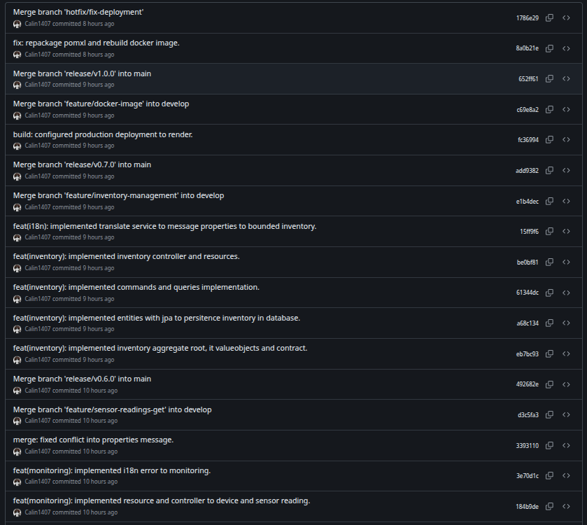{height=500px}

\newpage

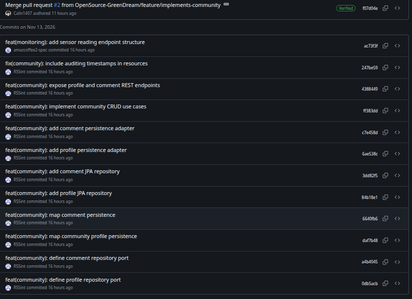{height=500px}

\newpage

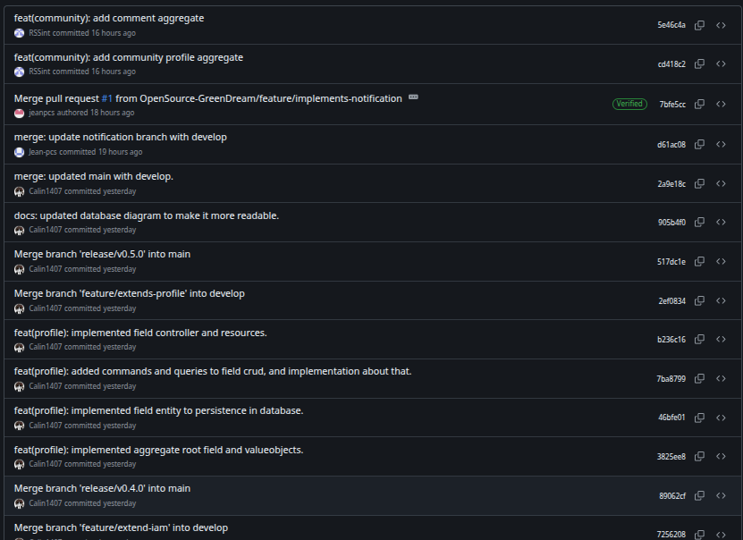{height=500px}

\newpage

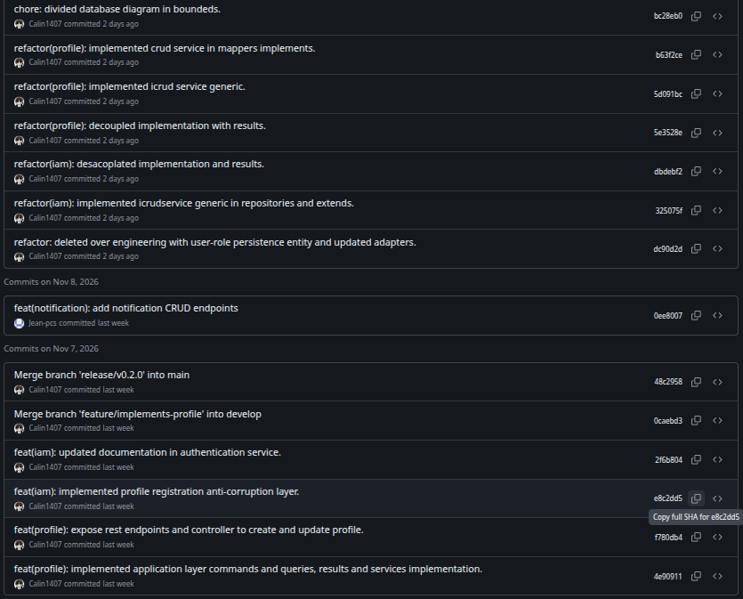{height=500px}

\newpage

## 5.2.3.5. Execution Evidence for Sprint Review

- Desarrollo de funcionalidades como "community", "commercial" y "analytics", dentro del Front End de la aplicación web CultivaTech, utilizando buenas prácticas de Clean Architecture y Domain Driven Design para la implementación de los bounded contexts.

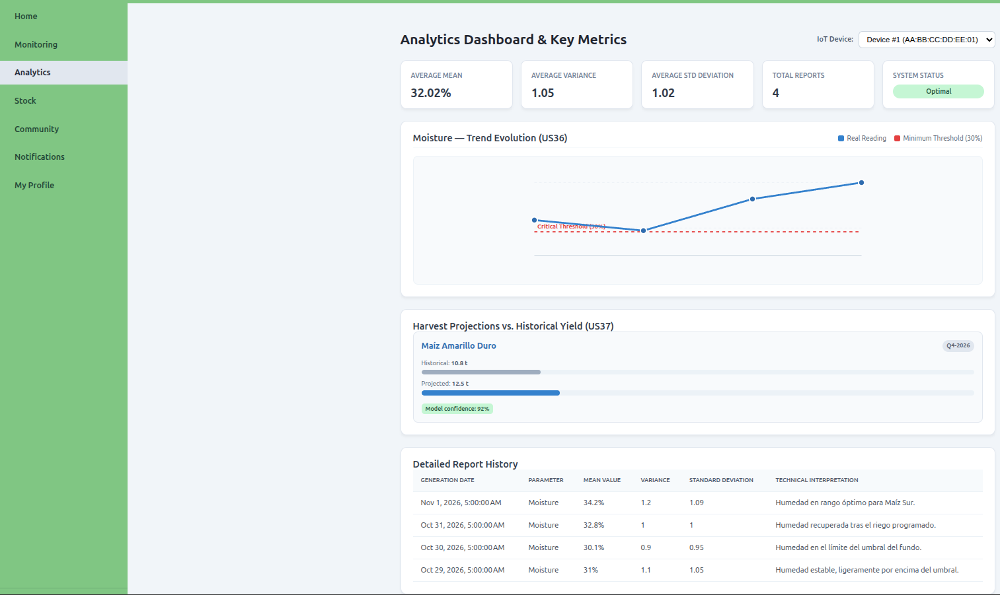{height=500px}

\newpage

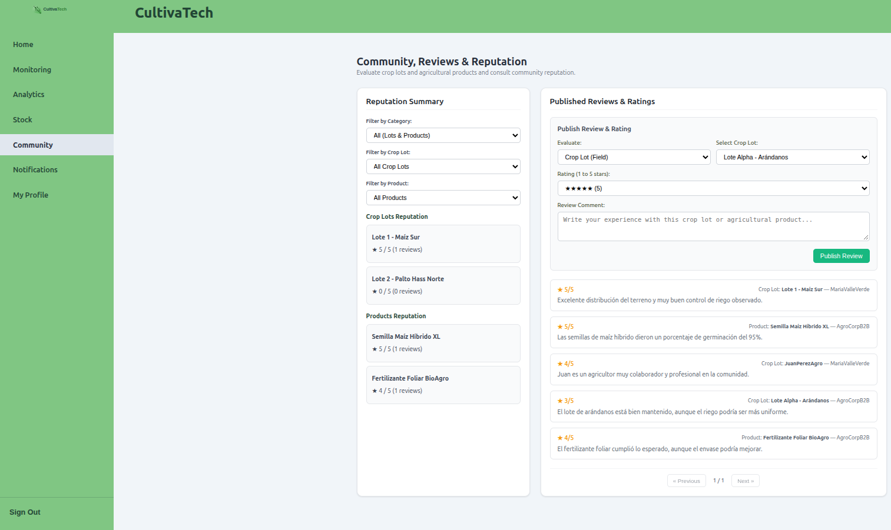{height=500px}

\newpage

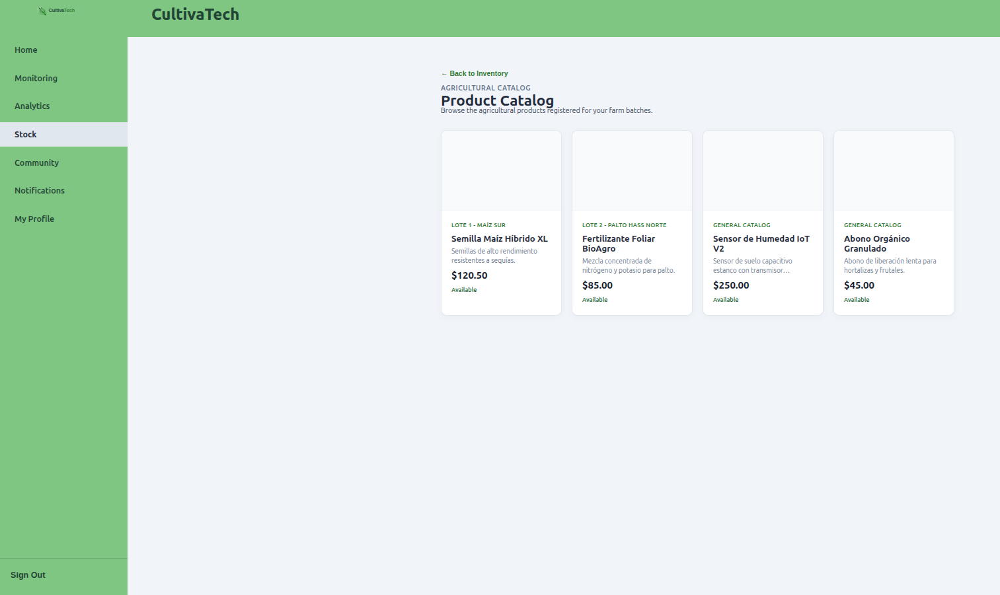{height=500px}

\newpage

{height=500px}

\newpage

**Recomendación para el siguiente Sprint**: Continuar con la implementación del Back End, integrandolo a los servicios de Front End, y realizar mejoras en el apartado de diseño UX.

- Desarrollo de endpoints REST para los bounded contexts de "Profile", "Inventory", "Notification", "IAM", "Community" y "Monitoring", utilizando buenas prácticas de Clean Architecture y Domain Driven Design para la implementación de los bounded contexts.

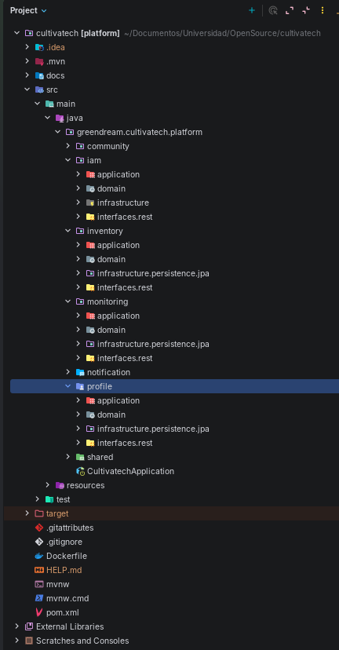{height=500px}

\newpage

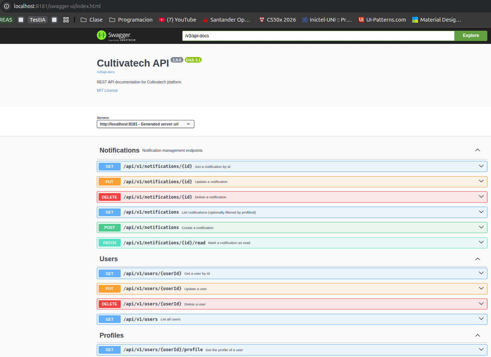{height=500px}

\newpage

**Recomendación para el siguiente Sprint**: Continuar con la implementación de los endpoints REST, integrandolos a los servicios de Front End.

## 5.2.3.6. Services Documentation Evidence for Sprint Review

Durante el sprint se desarrollo del Front End, se dirigio a la solución de la deuda tecnica encontrada en el sprint 2, y se implementaron nuevas views para los bounded Community, Analytics y Commercial.

Se hace observacion que se sigue usando Mocks para la representacion de
informacion de los servicios Back End. Debido a que el desarrollo de los endpoints REST del Back End siguen en proceso de implementacion, y se espera que para el siguiente sprint se pueda integrar los servicios del Back End al Front End.

Asimismo, se comenzo el desarrollo del Back End, implementando los endpoints REST de los bounded contexts de Profile, Inventory, Notification, IAM, Community y Monitoring. Implementando buenas practicas de Clean Architecture y Domain Driven Design para la implementacion de los bounded contexts. 

A continuación se presentan los endpoints desarrollados durante el sprint 3, junto con sus respectivas evidencias de documentación.

- IAM

| Method | Path | Success | Declared errors |
|---|---|---|---|
| POST | `/api/v1/authentication/sign-up` | 201 | 400, 409 |
| GET | `/api/v1/users` | 200 | — |
| GET | `/api/v1/users/{userId}` | 200 | 404 |
| PUT | `/api/v1/users/{userId}` | 200 | 400, 404, 409 |
| DELETE | `/api/v1/users/{userId}` | 204 | 404 |
| GET | `/api/v1/roles` | 200 | — |
| GET | `/api/v1/roles/{roleId}` | 200 | 404 |
| POST | `/api/v1/roles` | 201 | 400, 409 |
| PUT | `/api/v1/roles/{roleId}` | 200 | 400, 404 |
| DELETE | `/api/v1/roles/{roleId}` | 204 | 404, 409 |

- Profile and fields

| Method | Path | Success | Declared errors |
|---|---|---|---|
| POST | `/api/v1/users/{userId}/profile` | 201 | 400, 409 |
| GET | `/api/v1/users/{userId}/profile` | 200 | 400, 404 |
| PUT | `/api/v1/users/{userId}/profile` | 200 | 400, 404 |
| GET | `/api/v1/profiles/{profileId}/fields` | 200 | 400 |
| GET | `/api/v1/fields/{fieldId}` | 200 | 400, 404 |
| POST | `/api/v1/profiles/{profileId}/fields` | 201 | 400, 404 |
| PUT | `/api/v1/fields/{fieldId}` | 200 | 400, 404 |
| DELETE | `/api/v1/fields/{fieldId}` | 204 | 400, 404 |

- Inventory

| Method | Path | Success | Declared errors |
|---|---|---|---|
| GET | `/api/v1/inventories` | 200 | — |
| GET | `/api/v1/inventories/{inventoryId}` | 200 | 400, 404 |
| GET | `/api/v1/profiles/{profileId}/inventories` | 200 | 400 |
| GET | `/api/v1/fields/{fieldId}/inventories` | 200 | 400 |
| POST | `/api/v1/profiles/{profileId}/inventories` | 201 | 400, 404 |
| PUT | `/api/v1/inventories/{inventoryId}` | 200 | 400, 404 |
| DELETE | `/api/v1/inventories/{inventoryId}` | 204 | 400, 404 |

- Monitoring

| Method | Path | Success | Declared errors |
|---|---|---|---|
| GET | `/api/v1/devices` | 200 | — |
| GET | `/api/v1/devices/{deviceId}` | 200 | 400, 404 |
| GET | `/api/v1/fields/{fieldId}/devices` | 200 | 400 |
| POST | `/api/v1/fields/{fieldId}/devices` | 201 | 400, 409 |
| PUT | `/api/v1/devices/{deviceId}` | 200 | 400, 404 |
| DELETE | `/api/v1/devices/{deviceId}` | 204 | 400, 404, 409 |
| GET | `/api/v1/sensor-readings` | 200 | — |
| GET | `/api/v1/devices/{deviceId}/sensor-readings` | 200 | 400 |
| POST | `/api/v1/devices/{deviceId}/sensor-readings` | 201 | 400, 404 |
| DELETE | `/api/v1/sensor-readings/{sensorReadingId}` | 204 | 400, 404 |

- Notifications

| Method | Path | Success | Declared errors |
|---|---|---|---|
| POST | `/api/v1/notifications` | 201 | 400 |
| GET | `/api/v1/notifications?profileId=` | 200 | — |
| GET | `/api/v1/notifications/{id}` | 200 | 404 |
| PUT | `/api/v1/notifications/{id}` | 200 | 400, 404 |
| PATCH | `/api/v1/notifications/{id}/read` | 200 | 404 |
| DELETE | `/api/v1/notifications/{id}` | 204 | 404 |

- Community

| Method | Path | Success | Declared errors |
|---|---|---|---|
| GET | `/api/v1/community-profiles?profile_id=` | 200 | — |
| GET | `/api/v1/community-profiles/{id}` | 200 | 404 |
| POST | `/api/v1/community-profiles` | 201 | 400, 409 |
| PUT | `/api/v1/community-profiles/{id}` | 200 | 400, 404 |
| DELETE | `/api/v1/community-profiles/{id}` | 204 | 404 |
| GET | `/api/v1/comments?target_profile_id=&field_id=&product_id=` | 200 | — |
| GET | `/api/v1/comments/{id}` | 200 | 404 |
| POST | `/api/v1/comments` | 201 | 400 |
| PUT | `/api/v1/comments/{id}` | 200 | 400, 404 |
| DELETE | `/api/v1/comments/{id}` | 204 | 404 |

## 5.2.3.7. Software Deployment Evidence for Sprint Review

Back End Deployment: [https://cultivatech-backend-49n5.onrender.com/](https://cultivatech-backend-49n5.onrender.com/)

Back End Swagger Deployment: [https://cultivatech-backend-49n5.onrender.com/swagger-ui/index.html](https://cultivatech-backend-49n5.onrender.com/swagger-ui/index.html)

\newpage

Usando los servicios de *"filess.io"* se uso una base de datos ya publicada en la nube, para el desarrollo de los endpoints REST del Back End. 

En primera instancia se selecciona el tipo de base de datos a usar.

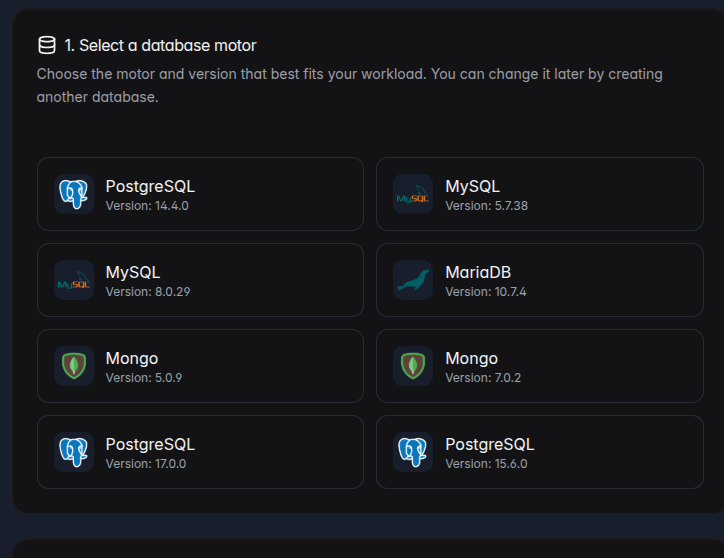{width=400px}

\newpage

En segunda instancia, con la base de datos configurada, procedemos a obtener las variables de entorno necesarias para la conexion a la base de datos.

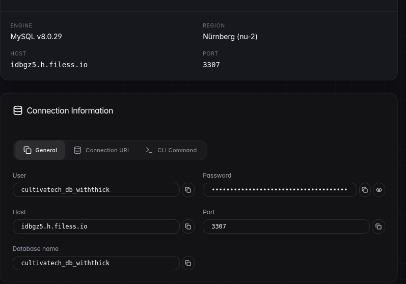{width=400px}

\newpage

Se procede a configurar el archivo *application.properties* del proyecto Back End en Render.

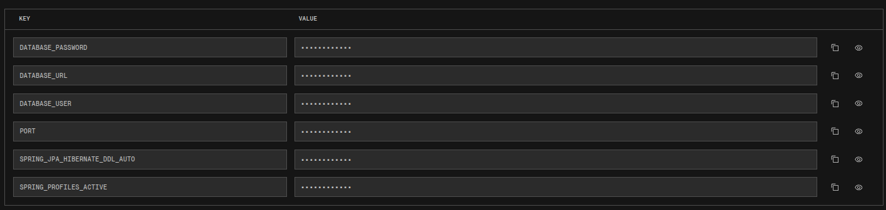{width=400px}

\newpage

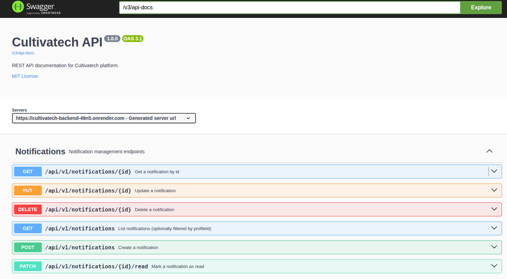{width=400px}

\newpage

**Recomendacion para el siguiente sprint**: filess.io es un tipo de base de datos compartida, permite el despligue sencillo y rápido del Back End. Sin embargo, tiene limitaciones de recursos como el limite de entidades persistidas. Por ello, se recomienda hacer un despliegue completo en Azure para el siguiente Sprint. 

## 5.2.3.8. Team Collaboration Insights during Sprint

\newpage

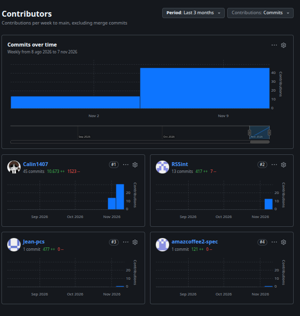{width=400px}

\newpage